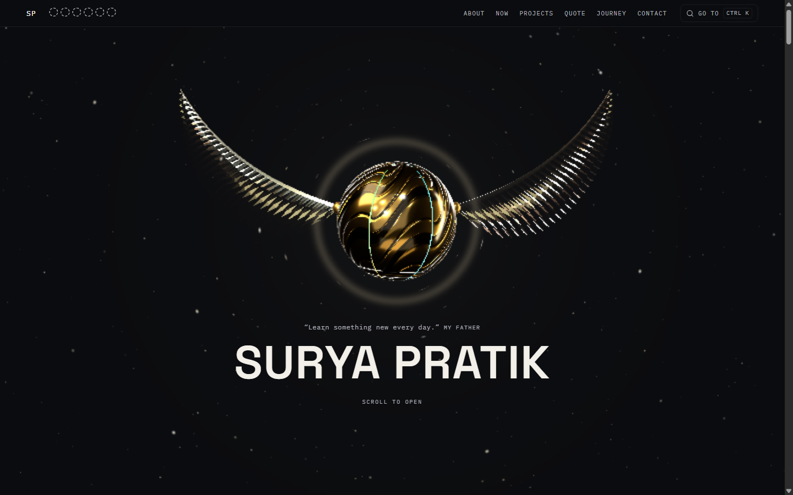
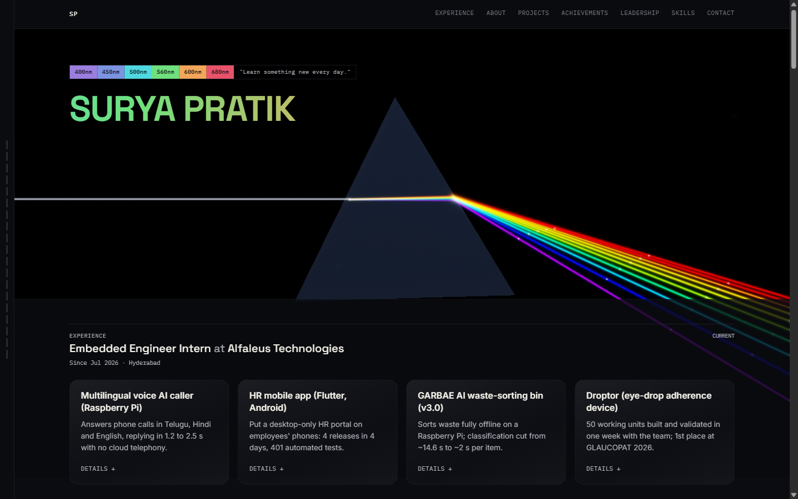
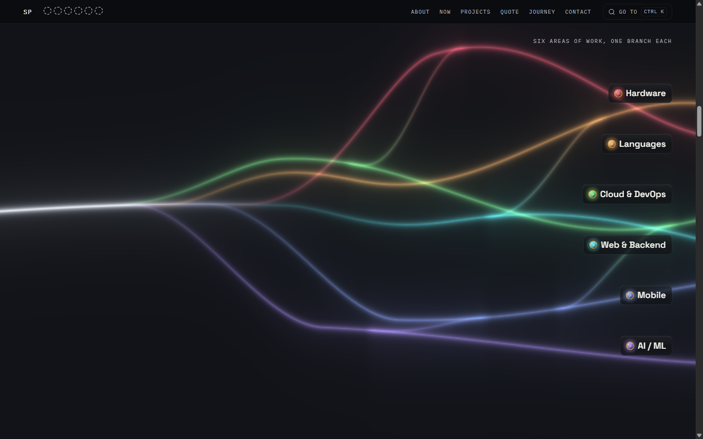
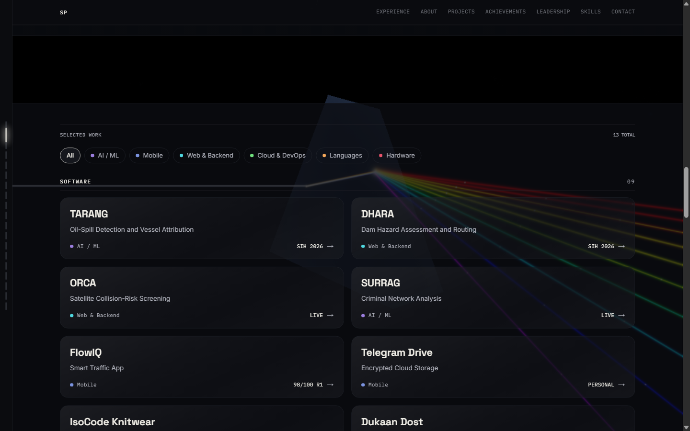
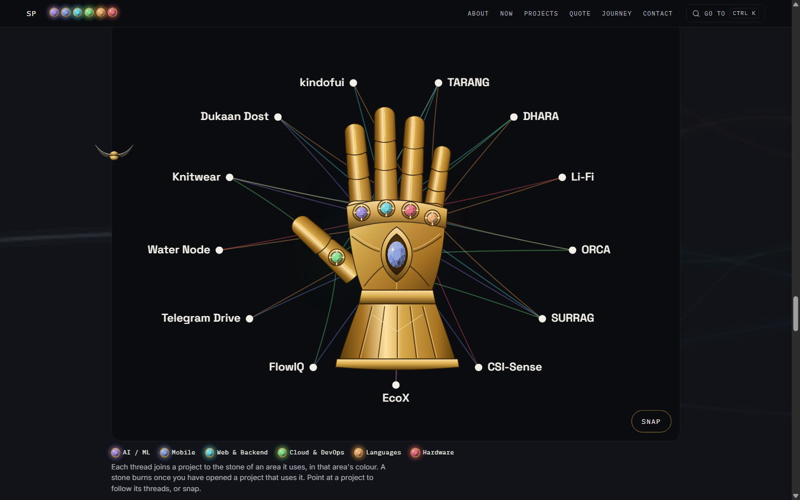
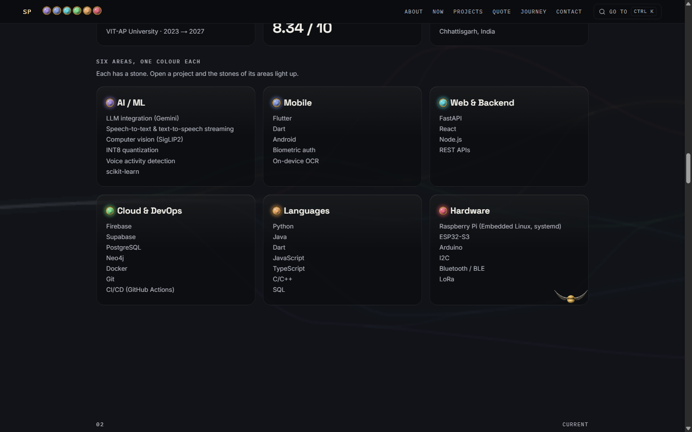

# Surya Pratik · Portfolio (v3)

My personal portfolio. I'm a Computer Science Engineering student at VIT-AP, and I build AI products: voice agents, LLM-backed tools, Flutter apps, and the hardware they run on.

Live at **https://suryapratik.vercel.app**



## Why there is a v3

The last version (v2) was built around a prism. White light came in from the left, refracted through simulated glass and split into six wavelengths, one for each area of work. It was the most technical thing I had made for the web, and I liked it.

But I never found a way to connect my projects to it. The prism sat behind the page as a backdrop, and the projects sat in front of it as cards. Nothing on the page tied a project back to the light. The six colours were there, but they didn't really mean anything: they made the page look good.

So I retired it and designed this one.

In v3 every colour has a job. There are six areas of work (AI / ML, Mobile, Web & Backend, Cloud & DevOps, Languages and Hardware), and each one is a stone in its own colour. The same stone appears everywhere a project uses that area: on its tile, on its page, in the top bar, and set in a gauntlet at the centre of the project web, where a thread runs from every project to each stone it uses. When you open a project, the stones of its areas light up, so the site shows you what you've explored.

The opening carries the same idea. A Golden Snitch flies in, opens as you scroll, and inside it the six areas start as one line and branch apart, one after another, into six. Those branches carry on quietly behind the page as you read on. One person, six areas, all from the same line.

| v2: the prism | v3: the Golden Snitch |
|---|---|
|  |  |
|  |  |

## What's in it

- **The opening:** a glass-winged Golden Snitch in three.js that reacts to the pointer, opens on scroll, and hands its six branches to a quiet layer behind the next sections, on one shared clock so the lines never jump.
- **Six areas, six stones:** one cut-gem stone per area, used everywhere; the stones fly up into the bar as you leave the opening.
- **A page for every project,** each drawn for that project rather than filled into a template: a satellite KD-tree search for ORCA, an evidence board for SURRAG, light pulses for the Li-Fi link, and so on.
- **The project web:** every project joined to the stones it uses, with a gauntlet at the centre and a snap.
- **My journey** as a wave, highs and lows, with every award on it.
- **My quote,** with a plot of sine and tangent to show what it means.
- Built to be quiet when it should be: reduced-motion support throughout, no layout that depends on the 3D loading, and a lighter path for devices without graphics acceleration.



## Versions

- **v1:** the first site.
- **v2:** the prism (screenshots above and in `docs/screenshots/prism-*`).
- **v3:** this one, the Golden Snitch version.

Builds are numbered and pinned by git tags (`build-1053` is v3).

## Tech

- [Next.js 16](https://nextjs.org/) (App Router, Turbopack) and React 19, fully static
- TypeScript, CSS Modules, design tokens in `app/globals.css`
- [three.js](https://threejs.org/) for the Snitch, with hand-written GLSL for the opening's light and the branching lines
- Atomic structure: `components/atoms`, `molecules`, `organisms`, `sections`, and one folder per project page in `components/worlds`
- Fonts with `next/font`: Space Grotesk, Inter and IBM Plex Mono

## Running it

```bash
git clone https://github.com/xeyynon/portfolio.git
cd portfolio
npm install
npm run dev
```

Then open http://localhost:3000.

Before shipping: `npm run build && npm run check:dashes && npm run lint`.

## Where things live

- `app/`: the routes (`/`, `/projects/[slug]`, the not-found page) and the global styles
- `components/`: everything on the page, by atomic level; `components/worlds/<project>` holds each project's own page
- `scene/`: the three.js Snitch and its shaders
- `lib/`: small shared logic (the stones' state, the wave clock, the command palette)
- `data/portfolioData.ts`: all the content, in one file
